# ReinChat 驭聊

> 为 **HarmonyOS 7 · 卓易通** 打造的极简液态玻璃 AI 聊天客户端  
> **v0.4.4** · Android (Kotlin + Jetpack Compose) · 可选自托管云端同步  
> Windows 桌面版（Tauri 2.12）源码在 `desktop/`，开发暂缓，未纳入本次发布。

<p align="center">
  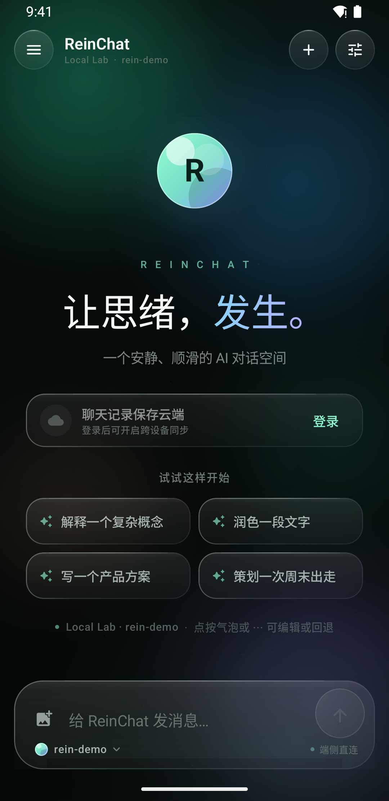
  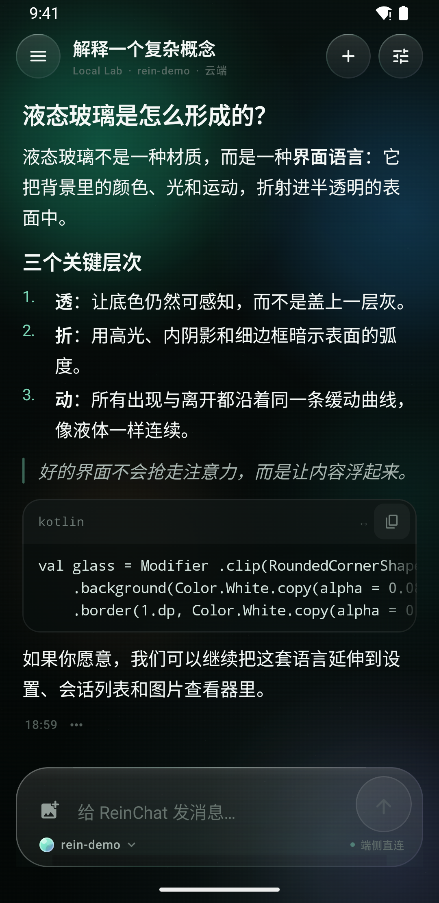
  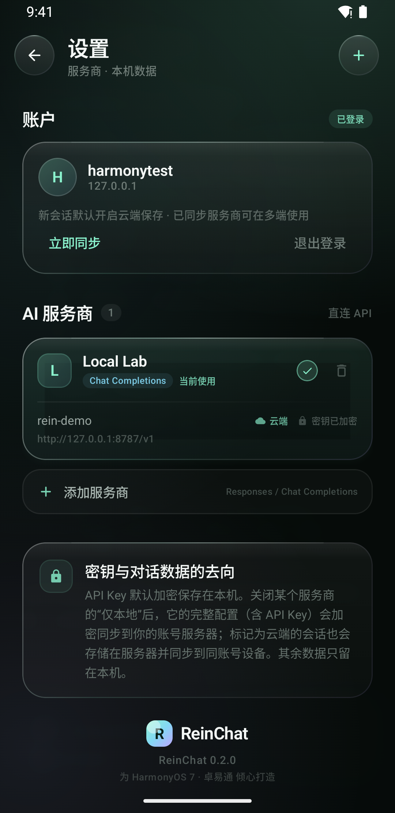
</p>

---

## 自动更新

Android 启动和回到前台时会请求：

`https://pan.szcmate.cn/f/x9rfm/version.txt`

格式：

```ini
[LatestVersion]
0.4.2
[MandatoryUpdate]
Yes
[DownloadURL]
https://pan.szcmate.cn/f/xxxx/ReinChat-0.4.3.apk
[UpdateNotes]
修复了一些已知问题。
```

- `LatestVersion` 高于当前版本才提示
- `MandatoryUpdate=Yes` 时弹窗不可关闭
- 弹窗显示 `UpdateNotes`
- 「立即更新」使用 App 内置下载，实时显示进度
- 下载完成后点击「安装更新」，交给 Android 安装器
- 「前往浏览器下载」使用浅灰色文字，打开外部下载页
- **发版顺序：先上传新 APK，再改 version.txt；否则会出现“更新后仍提示更新”的循环**

## 关于测试中的 AI 回答

**开发与截图验证期间的回答不是真实模型输出，也没有内置在 release App 中。**

这些文字来自 `tools/mock_server.py`，一个本地 SSE mock 服务，用来验证：

- `Chat Completions` 与 `Responses` 两种流式协议解析
- 流式 Markdown、打字光标、自动滚动
- 停止生成、失败气泡、图片 base64 请求
- 长篇回答、代码块、列表、引用等排版

真实使用时，ReinChat 会把你在设置中填写的 Base URL、模型和 API Key 用于请求你的服务商；App 本身没有预设回答。

---

## v0.2 新增：账号与云端同步

v0.2 增加了一套**可选**的账号系统，后端位于 [`server/`](server/README.md)，使用 Go + SQLite，可部署在 Debian 12 VPS 上，由 Caddy 自动签发 HTTPS。

### 账号

- 用户名 + 密码注册、登录；用户名全站唯一且不区分大小写
- 用户名 3–32 字符，支持中文、英文、数字与 `_ - .`
- 密码 8–128 字符；服务端使用 bcrypt 存储，登录后签发 30 天有效的 Bearer token
- App 自动保存登录状态；退出登录会移除本机缓存的云端会话与同步服务商
- 默认服务器：`https://reinchat.markjy.com`，也可在登录页填写自建地址

### 新会话的“聊天记录保存云端”

- 只有**新建会话**时才能开启；开启后该会话永久为云端会话，App 内不再提供关闭入口
- 已经有消息的本地会话不能中途转为云端会话
- 登录用户新建会话时默认开启；未登录用户该项禁用
- 云端会话会显示在会话抽屉中，并带云朵标识；对话页副标题显示“云端”或“仅本地”
- 云端会话在发送、编辑、回退、停止、重命名后自动同步；图片会先上传，再引用远端文件 ID
- 其他设备登录同一账号后可以查看并继续对话
- 会话页下拉式“立即同步”/回到前台时自动拉取最新数据

### 服务商配置同步

- 在服务商编辑器中新增 **“仅保存在本机”** 开关，默认开启
- 只有**关闭**该开关的服务商才会同步；未登录时该开关固定开启且不可修改
- 同步内容包括完整配置：名称、协议、Base URL、模型、系统提示词、参数和 **API Key**
- API Key 在传输时走 HTTPS，在服务器端使用 AES-256-GCM 加密落库
- 服务商卡片会标记“仅本地”或“云端”

> 关闭“仅保存在本机”前请确认：你的 API Key 会被上传到你填写的账号服务器。服务器管理员在技术上可以解密已同步的 Key。只应该同步你信任的服务商配置。

### 云端数据模型

| 数据 | 本地 | 云端 |
| --- | --- | --- |
| 会话 / 消息 | 始终保留在本机 | 仅 `cloud=true` 的会话上传 |
| 图片 | 应用私有目录 | 云端会话的图片上传到 `/files` |
| 服务商 | 全部保留在本机 | 仅 `localOnly=false` 的上传 |
| 账号 token | 本机 AES-GCM 加密的 settings | 服务端仅保存 SHA-256 哈希 |

退出登录、token 失效或账号切换时，本机缓存的云端会话和同步服务商会被清理，避免把上一个账号的数据展示给下一个账号；重新登录会从服务器拉取。

---

## v0.1.1 修复（来自 HarmonyOS 设备反馈）

| 问题 | 处理 |
| --- | --- |
| 服务商配置退出重进后丢失 | 将依赖 AndroidKeyStore 的配置信封替换为**可跨进程持久化的应用本地 AES-GCM 密钥**；增加写入校验、原子落盘和**同步保存**，不再依赖异步写入窗口。旧格式仍会尝试读取，成功时自动迁移。 |
| 只能点消息右下角的三点展开菜单 | **现在点按整条消息气泡即可展开/收起操作菜单**；用户图片、代码复制按钮等子控件仍优先响应，不会误触。 |
| 密钥持久化说明不准确 | 文案从“Android Keystore”改为“应用私有目录加密保存”，与卓易通兼容层的实际行为一致。 |

---

## 功能范围

### 对话

- **完整流式对话**：SSE 增量先进入缓冲，再以 16ms 自适应帧率平滑吐出；带闪烁光标、思考动画和自动跟随
- **平滑流式输出**：按网络积压量自适应加速，小增量接近阅读节奏，大积压快速追上，网络结束时 flush 剩余文本
- **推理过程**：支持 `reasoning_content` / Responses reasoning 事件；思考时自动展开思考块，正文开始自动收起，可手动展开/收起
- **思考强度**：服务商可按 `低=low / 高=high / 最高=max / 自动` 调整 `reasoning_effort`
- **悬浮玻璃层**：标题栏和输入栏覆盖在消息之上，背景高斯模糊 + 半透明暗色 tint，滚动时文字从玻璃下方隐约透出
- **标题栏渐变模糊**：顶部模糊最强，向下逐渐减到 0，tint 同步淡出，消除硬边界
- **稳定视窗**：生成过程中不再自动跟随到底部；消息变长时保持当前阅读位置，可用右侧按钮回到最新
- **后台生成**：前台服务 + 常驻通知，切到后台后尽量保持流式连接；切换会话也不会再掐断生成
- **对话回退**：回退到任意一条消息，并支持 Snackbar 一键撤销
- **对话编辑**：编辑任意用户消息，截断其后的分支并重新请求
- **停止生成**：半途停止后保留已有文本，标记“已停止”
- **Markdown**：标题、列表、引用、行内样式、链接、代码块与代码复制；未闭合片段在流式中优雅降级
- **消息操作**：点按整条气泡展开菜单；复制、编辑、回退到此处
- **附件图片**：最多 4 张，系统图片选择器 / SAF，自动压缩到 1600px JPEG，以 `data:image/jpeg;base64,...` 发送
- **图片查看**：全屏查看、双指缩放、拖动

### 会话管理

- 自动以第一句提问命名
- 本地持久化，重启后恢复
- 抽屉式会话面板：搜索会话和消息内容、重命名、删除、新建对话
- 云端会话带云朵标识，删除会同步删除服务器副本
- 图片随会话存放在应用私有目录，删除会话时一并清理

### 服务商配置

- 多服务商管理、默认服务商切换
- 同一服务商可填写多个模型（英文逗号分隔），在对话页随时切换
- 思考强度：自动 / 低(low) / 高(high) / 最高(max)，通过 `reasoning_effort` 发送
- 推理模型返回的 `reasoning_content` 显示为独立思考块
- 两种协议：
  - **Responses** → `{base}/responses`
  - **Chat Completions** → `{base}/chat/completions`
- 服务商模板：OpenAI、DeepSeek、OpenRouter、自定义
- 系统提示词、temperature、最大输出 token
- API Key 可留空（适合本地模型）；非空时使用 `Authorization: Bearer`
- 配置使用应用本地 AES-GCM 加密，原子写入应用私有目录
- “仅本地”与“云端同步”可选，默认仅本地

### 液态玻璃 UI

- 多层动态极光背景、镜面边缘、玻璃高光与彩色折射描边
- 自定义 **cubic-bezier** 缓动与弹簧按压动画
- 页面/抽屉滑入、气泡入场、菜单展开、发送按钮 morph、思考点、流式光标
- 深色沉浸式布局 + edge-to-edge + IME 跟随
- 登录页、账户卡片、同步开关沿用同一套玻璃材质
- 无 Google 服务依赖；不使用 Google 登录

---

## 安装

### 正式包

```text
dist/ReinChat-0.4.4.apk
```

已使用项目内 release keystore 签名，可直接侧载：

```bash
adb install -r dist/ReinChat-0.4.4.apk
```

Release 证书 SHA-256：

```text
6d67dbefbadbb1b296164d95453ba1c29018aee41e13cd54a232d3a9f2f1a161
```

### 调试包（与正式包可共存）

```text
dist/ReinChat-0.4.4-debug.apk
```

包名为 `com.reinchat.app.debug`。调试包额外包含演示 seed Activity，不进入 release。

### Windows 桌面版（开发暂缓）

桌面端源码位于 [`desktop/`](desktop/README.md)，使用 **Tauri 2.12 + Rust + 原生 TypeScript + Vite**，不引入 React/Vue，手写 DOM。目前已完成调试版运行验证，但按当前安排**暂缓发布**，本轮不提供 Windows 安装包。

已实现并验证的桌面能力（源码保留，后续可继续）：

- 流式对话、停止、编辑、回退、错误重试、图片附件
- 服务商多模型管理，模型字段支持英文逗号分隔并在对话页切换
- 账号注册/登录、云端会话、云端服务商同步
- Windows DPAPI 加密本机状态文件

后续恢复开发时再生成安装包并补充构建说明。

### HarmonyOS 7 / 卓易通提示

- 建议通过文件管理器 / 卓易通安装器侧载 APK；不需要 GMS。
- 图片选择在系统不支持 Photo Picker 时会自动走 SAF，不申请存储权限。
- 允许 HTTP Base URL（方便 Ollama、LM Studio、局域网网关等自建服务）；公网服务请使用 HTTPS。
- 登录服务器也可以填写局域网/自建地址；如果填 `http://`，账号密码、token 与服务商 Key 会以明文经过该网络，请仅在可信网络使用。
- minSdk 26 / targetSdk 35；无 native 业务库，ARM64 鸿蒙设备可直接安装。

---

## 部署云端服务（Debian 12）

完整说明见 [`server/README.md`](server/README.md)。

### 一键部署到当前 1Panel 服务器

本机已配置 `root@rainMark` 免密登录（注意 SSH 配置里的 Host 是 `rainMark`，大小写敏感）。在项目根目录执行：

```bash
bash deploy.sh
```

脚本会：

- 运行 `go test` / `go vet`，交叉编译 `linux/amd64`
- 通过 `scp` 上传，并**轮询远端文件大小显示实时上传进度**
- 上传到 `/opt/1panel/www/sites/reinchat.markjy.com/reinchat-server`
- 安装并启动 `reinchat.service`，监听 `127.0.0.1:10089`
- 设置 `systemctl enable`，服务器重启后自动启动
- 首次部署生成 `REINCHAT_MASTER_KEY`；后续部署保留原密钥
- 数据放在 `/var/lib/reinchat`，以独立的 `reinchat` 用户运行

可用环境变量覆盖默认值：

```bash
REMOTE=root@rainMark REMOTE_DIR=/opt/1panel/www/sites/reinchat.markjy.com \
SERVICE=reinchat.service PORT=10089 bash deploy.sh
```

> 当前 1Panel 的 `reinchat.markjy.com` 站点配置了 80 端口反向代理；如需使用 App 默认的 `https://reinchat.markjy.com`，请先在 1Panel 为该站点申请并启用 SSL 证书。临时测试可在登录页把服务器地址改为 `http://reinchat.markjy.com`（不建议在不可信网络使用明文 HTTP）。

### Docker Compose 方式（备选）

1. 把 `reinchat.markjy.com` 的 DNS `A` 记录指向 VPS，放行 80/443。
2. 将 `server/` 上传到 VPS，例如 `/opt/reinchat/server`。
3. 生成主密钥并填写 `.env`：

   ```bash
   cd /opt/reinchat/server
   cp .env.example .env
   openssl rand -base64 32   # 把输出写入 .env 的 REINCHAT_MASTER_KEY
   nano .env
   ```

4. 启动：

   ```bash
   docker compose up -d --build
   ```

Caddy 会自动申请 HTTPS 证书，并将 `https://reinchat.markjy.com/api/v1/*` 反代到内部 `app:8080`。端口 8080 不发布到公网。

需要长期备份：

- Docker volume `reinchat_data`（SQLite 与图片）
- **主密钥**（`REINCHAT_MASTER_KEY`）。丢失主密钥后，已同步的服务商 API Key 无法解密。

服务器 API 一览（均以 `/api/v1` 为前缀，`/healthz` 除外）：

```text
POST   /auth/register        POST /auth/login
GET    /auth/me              POST /auth/logout
GET    /providers            PUT  /providers/{id}     DELETE /providers/{id}
GET    /conversations        POST /conversations
GET    /conversations/{id}   PUT  /conversations/{id} DELETE /conversations/{id}
POST   /files                GET  /files/{id}
GET    /healthz
```

会话更新使用 `baseVersion` 乐观锁；版本冲突返回 409 和服务器当前会话。

---

## 配置服务商

1. 点击右上角设置，选择 **添加服务商**。
2. 选择协议：
   - OpenAI 原生 Responses：Base 一般填 `https://api.openai.com/v1`
   - 兼容 Chat Completions：DeepSeek 填 `https://api.deepseek.com/v1`，OpenRouter 填 `https://openrouter.ai/api/v1`
3. 填入模型 ID，例如 `gpt-4.1-mini`、`deepseek-chat` 或自建网关的模型名。
4. API Key 可留空；保存后配置卡会显示“密钥已加密”。
5. 在输入框左下角的服务商芯片中快速切换当前服务商。

请求端点为：

```text
Responses:        {base}/responses
Chat Completions: {base}/chat/completions
```

如果 Base 已经以 `/responses` 或 `/chat/completions` 结尾，不会重复拼接。

### 云端同步

1. 在“设置 → 账户”登录或注册。
2. 打开某个服务商，在“仅保存在本机”处关闭开关，保存。
3. 配置卡出现“云端”标记即表示已上传；其他设备登录后会看到它并自动设为可用服务商。
4. 如果重新打开“仅保存在本机”，App 会删除服务器上的该服务商副本。

---

## 构建

环境：

- JDK 17
- Android SDK Platform 35 + Build Tools 35.x
- 项目自带 Gradle Wrapper 8.9
- Go 1.25+（仅构建云服务时需要）

```bash
# debug
./gradlew assembleDebug

# release（使用 keystore.properties）
./gradlew assembleRelease

# 单元测试
./gradlew testDebugUnitTest
```

Windows 下使用 `gradlew.bat`。签名材料：

- `keystore/reinchat-release.jks`
- `keystore.properties`

正式发版前请替换为你自己的 keystore；更换签名会导致无法覆盖升级。

云服务端：

```bash
cd server
go test ./...
go vet ./...
./build-linux.ps1        # Windows
# 或 sh build-linux.sh   # Linux/macOS
```

---

## 项目结构

```text
app/src/main/java/com/reinchat/app/
├── MainActivity.kt / ReinChatApplication.kt
├── data/
│   ├── Models.kt                 # 会话/消息/服务商/云端账号模型
│   ├── ConversationStore.kt      # 会话 JSON 持久化
│   ├── SettingsStore.kt          # 服务商/账号配置持久化 + 迁移
│   ├── LocalSettingsVault.kt     # 可跨进程的本地 AES-GCM 信封
│   ├── SecureVault.kt            # 旧版 AndroidKeyStore 信封（只读兼容）
│   └── ImageStore.kt             # 图片导入、压缩、EXIF 纠正、编码
├── net/
│   ├── ApiEndpoint.kt            # AI Base URL 规范化与端点拼接
│   ├── SseParser.kt              # 增量 SSE 解析
│   ├── ChatApiClient.kt          # Responses / Chat Completions 流式客户端
│   └── CloudApiClient.kt         # 账号、服务商、会话、图片云同步客户端
├── vm/
│   ├── ChatUiState.kt
│   └── ChatViewModel.kt          # 发送/停止/回退/编辑/会话/设置/云端同步
└── ui/
    ├── ReinChatRoot.kt
    ├── screens/                  # Chat / 抽屉 / 设置 / 服务商编辑 / 登录 / 图片查看
    └── components/               # 液态玻璃、极光、消息、Markdown、Composer

deploy.sh                         # 本地构建 + scp 实时进度 + systemd 一键部署

server/
├── *.go                          # Go 后端与 httptest 集成测试
├── schema.sql                    # 幂等 SQLite schema
├── Dockerfile / docker-compose.yml / Caddyfile
├── .env.example
├── bin/reinchat-server-linux-amd64
└── README.md                     # 中文部署、备份、安全说明
```

测试与设计文档：

- [`docs/DESIGN.md`](docs/DESIGN.md)：视觉 tokens、动效曲线、交互决策
- [`docs/SERVER_V0.4_PLAN.md`](docs/SERVER_V0.4_PLAN.md)：账号等级、升级工单、AI 中转、Vue2 Web/Admin 规划
- `app/src/test/`：SSE、URL、Markdown 解析单测
- `server/*_test.go`：Go 后端集成测试
- `app/src/debug/`：调试 seed Activity（不进入 release）
- `tools/mock_server.py`：本地 SSE 演示 / 验证服务

---

## 本地验证

### 本地 mock AI

```bash
# 1. 启动 mock（主机）
python tools/mock_server.py

# 2. 让模拟器通过 127.0.0.1 访问主机
adb reverse tcp:8787 tcp:8787

# 3. 安装 debug 包并打开调试 seed
adb shell am start -n com.reinchat.app.debug/com.reinchat.app.DebugSeedActivity \
  --ez seed_demo true
```

`seed_demo` 会写入两个服务商与三段演示会话来生成截图；不会进入 release APK。

### 本地云服务

```bash
cd server
export REINCHAT_MASTER_KEY="$(openssl rand -base64 32)"
export REINCHAT_DATA_DIR="$PWD/data"
export REINCHAT_ADDR="127.0.0.1:8080"
go run . &

adb reverse tcp:8080 tcp:8080

# 只写入本地服务器地址并打开 App（不写演示服务商/会话）
adb shell am start -n com.reinchat.app.debug/com.reinchat.app.DebugSeedActivity \
  --ez server_only true
```

然后在 App 内注册账号，测试云端开关、服务商同步和多端登录。

---

## 测试

客户端 JVM 单元测试：

```text
./gradlew testDebugUnitTest
20 tests passed
```

服务端：

```text
cd server
go test ./... -count=1
go vet ./...
10 tests passed
```

本轮手工回归（本地 Go 服务 + Android 模拟器）：

- [x] 注册新账号并自动登录
- [x] 账号、token 与服务商配置在 App 重启后保留
- [x] 登录后新建会话默认开启“聊天记录保存云端”
- [x] 未登录时云端开关禁用；服务商“仅保存在本机”固定开启
- [x] 云端会话创建 → 服务端出现会话与消息
- [x] 清空 App 数据后重新登录 → 云端会话出现在抽屉
- [x] 在第二台“设备”继续同一云端会话 → 服务端版本从 3 增至 5，消息数 4 → 6
- [x] 关闭服务商“仅保存在本机” → 服务端出现配置（含 API Key）；清空重登后自动恢复并设为可用
- [x] 服务商卡片显示“云端”，云端会话页副标题显示“云端”
- [x] release APK 安装、默认服务器地址 `https://reinchat.markjy.com`、签名校验
- [x] 服务商模型填写 `rein-demo,rein-demo-2` 后，设置卡显示 `+1`，对话页可切换并更新副标题/输入区模型
- [x] 错误回复气泡操作菜单出现“重试”，点击后会重新请求该提问
- [x] 零宽字符、NBSP、换行、变体连字符、中文/全角字符的 API Key 清理单测通过
- [x] API Key 中的中文（如 U+65F6）会先被移除，不再触发 HTTP 请求头错误
- [x] 平滑流式输出：增量缓冲 + 16ms 自适应帧循环；模拟器 350ms 截图已能看到半截文本与光标，而非整段跳出
- [x] `###标题`（无空格）解析为 Heading，单测通过
- [x] 模拟 reasoning_content：思考块自动展开，正文开始自动收起；点击可再次展开查看完整思维链
- [x] 模型选择弹窗显示 自动/低/高/最高 四档思考强度，映射 low/high/max
- [x] HyperOS 体验修复：标题栏/输入栏为悬浮玻璃层，Haze 背景高斯模糊 + 暗色 tint，滚动时文字从玻璃下方隐约透出
- [x] 标题栏使用 progressive blur：顶部 40dp 模糊，向下渐变到 0dp；tint 同步淡出，不再有硬边界
- [x] 流式生成期间视窗保持不动：同一条消息从 0.7s 到 3s 截图，顶部阅读锚点不变
- [x] 切到后台后前台服务继续流式生成；返回 App 可看到完整回复
- [x] 切换会话不再调用 stopStreaming，后台会话继续生成

云端图片消息的上传/下载路径已实现，服务端文件接口有自动化测试；本轮手工回归着重验证了会话与服务商同步，未单独在第二台设备上验证图片显示。

---

## 已知限制（v0.2）

- 云端不是端到端加密：服务器可以读取会话内容；同步的服务商 API Key 在服务器端加密存储，但服务器持有主密钥。只应把可信服务商加入云端。
- 同一云端会话若在两台设备**同时**发送消息，后写入的设备可能遇到版本冲突；当前策略是拉取服务器版本并提示，个别并发消息可能被覆盖。
- 云端开关一旦对某个会话开启就不可逆；本地历史会话不能补开云端。
- 不支持找回密码、邮箱、双因素登录；忘记密码需要管理员处理数据库。
- 不支持多账号同时登录；切换账号会移除上一个账号的本地云缓存。
- 云端同步按全量会话/消息拉取，未做分页；适合个人轻量使用。
- 服务器按单实例设计，SQLite 不适合水平扩展。
- Markdown 为轻量实现，不支持表格、嵌套列表、脚注。
- 不支持工具调用、reasoning 内容展示、流式 token 统计。
- 不支持自定义请求头、Azure `api-key` 认证等特殊服务商。
- 每次请求会重发历史图片，长图片会话的请求体可能较大。
- 图片上限 4 张；源文件上限 28 MB，最长边压缩至 1600px。
- 进程被强杀时，正在生成的最后不到 1 秒文本可能来不及写入磁盘。
- 应用本地 AES 密钥属于沙盒内加密，不等同于硬件级安全模块；Root 设备上的密钥保护能力有限。
- 允许明文 HTTP，请仅在可信局域网使用，公网优先 HTTPS。
- 未做证书锁定（certificate pinning）。

---

## 安全与隐私

- API Key 不写入日志。
- 本地配置以 AES-GCM 加密落盘；本地会话与图片保存在应用私有目录。
- 云端 token 以哈希形式存于服务端；密码使用 bcrypt。
- 云端服务商的 API Key 在服务端以 AES-256-GCM 加密存储；主密钥只在 `.env` 中，必须单独备份。
- 云端请求走 HTTPS；App 默认连接 `https://reinchat.markjy.com`。
- 退出登录会清理本机缓存的云端会话和同步服务商，避免跨账号泄露。
- 应用关闭了云备份 / 设备迁移中的数据提取（`allowBackup=false`）。
- AI 请求仍然直连你填写的服务商；只有会话同步请求会经过 ReinChat 服务器。

---

## 界面一览

| 首页 | 云端对话 | 消息操作 |
| --- | --- | --- |
|  |  | 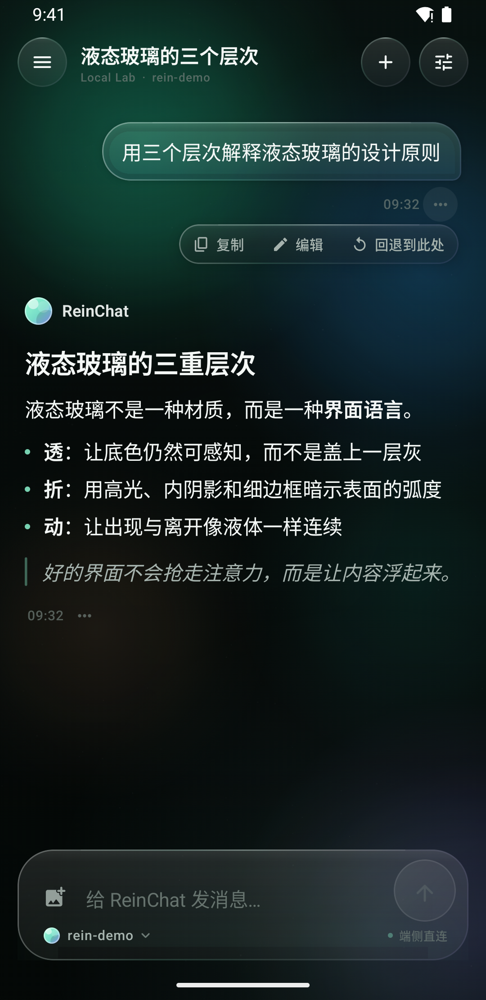 |

| 会话抽屉 | 图片对话 | 账户与服务商设置 |
| --- | --- | --- |
| 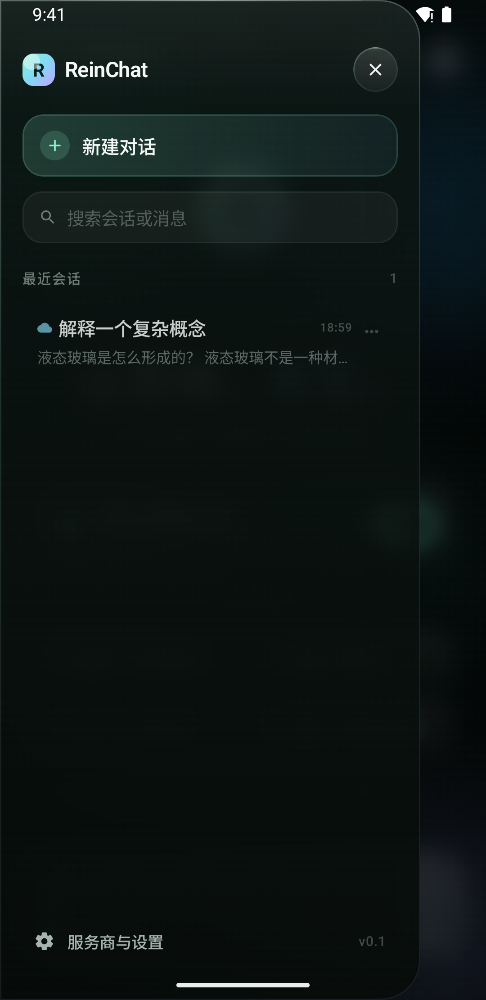 | 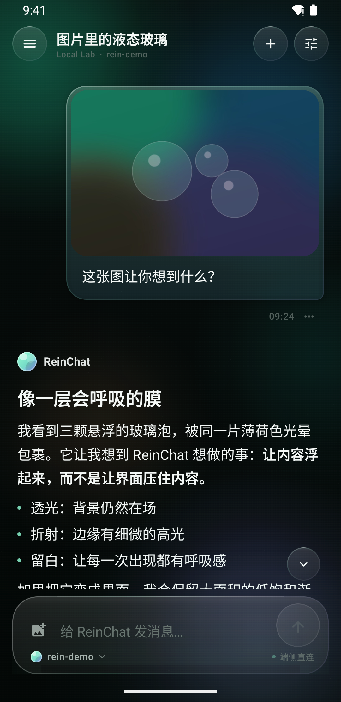 |  |

| 服务商同步 | 首次启动 | 登录 / 注册 |
| --- | --- | --- |
| 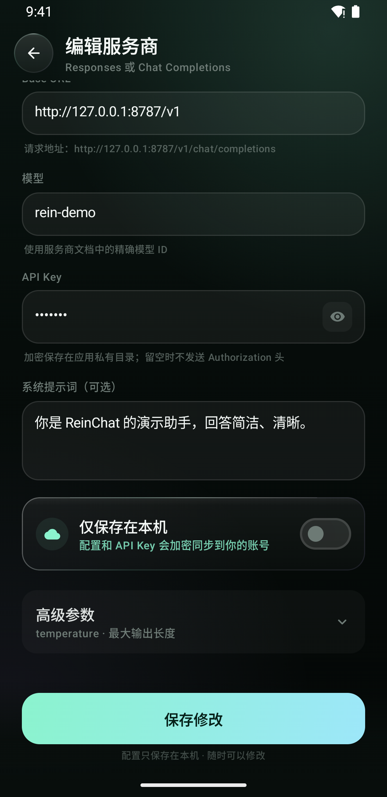 | 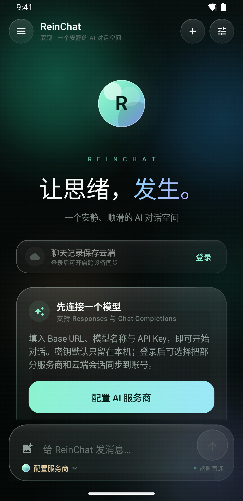 | 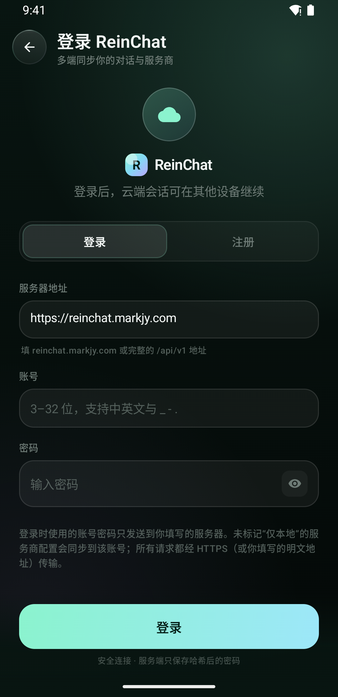 |

| 多模型切换 | 错误重试 |
| --- | --- |
| 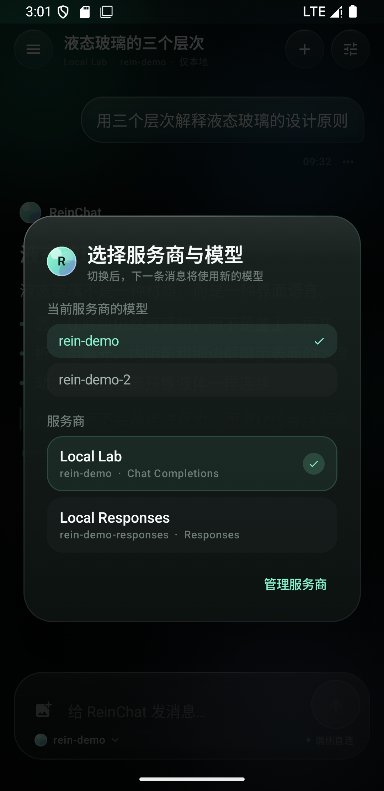 | 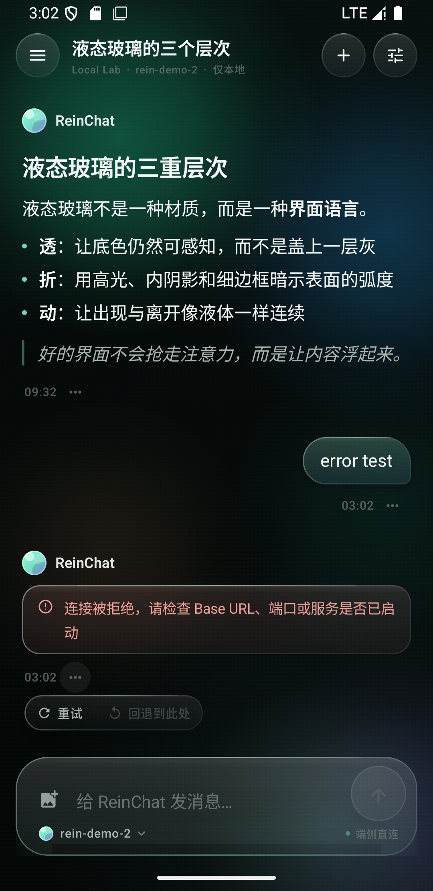 |

| 平滑流式输出 | 思考过程 |
| --- | --- |
| 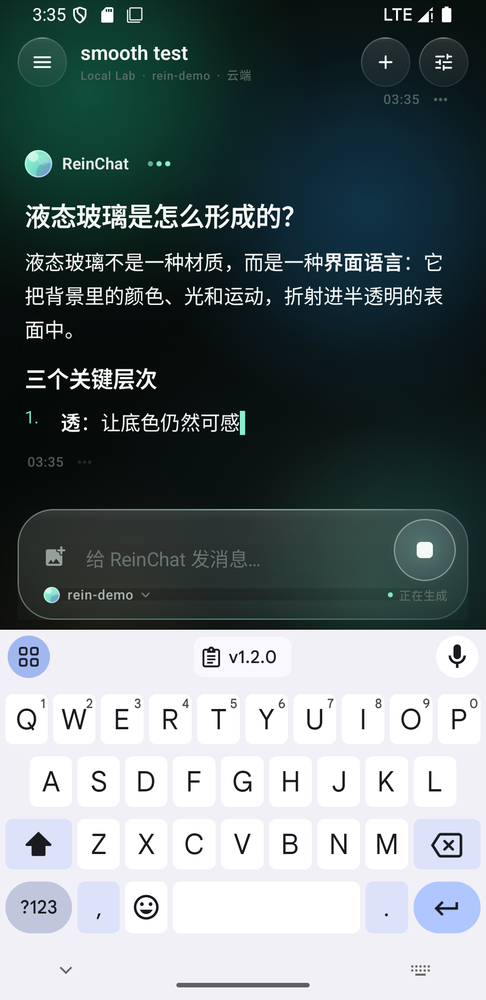 | 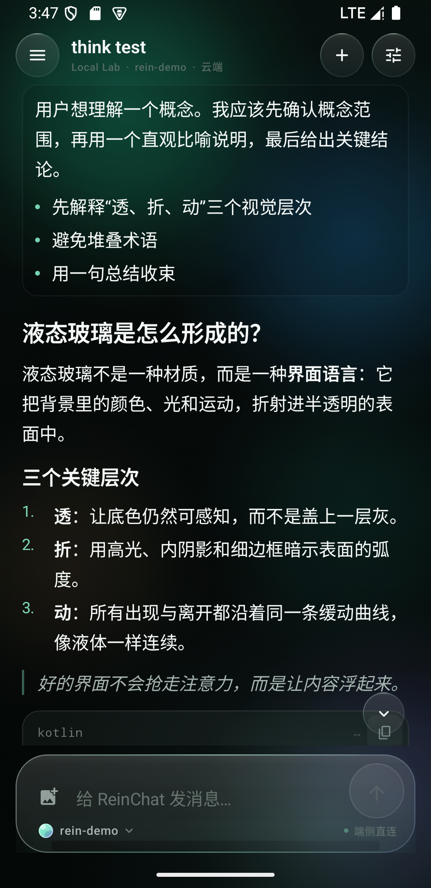 |

| 思考强度 | 悬浮玻璃层 |
| --- | --- |
| 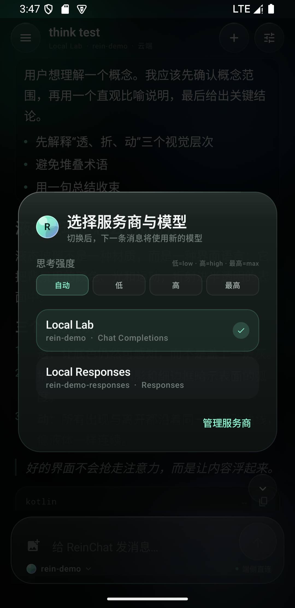 | 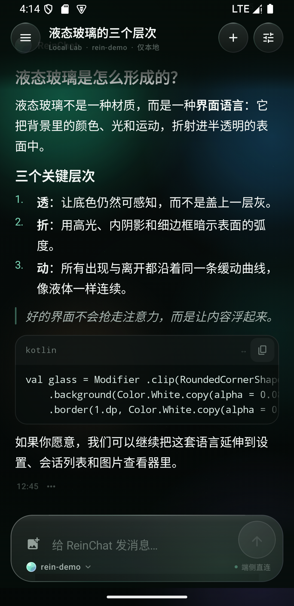 |

| 生成时视窗保持 |
| --- |
| 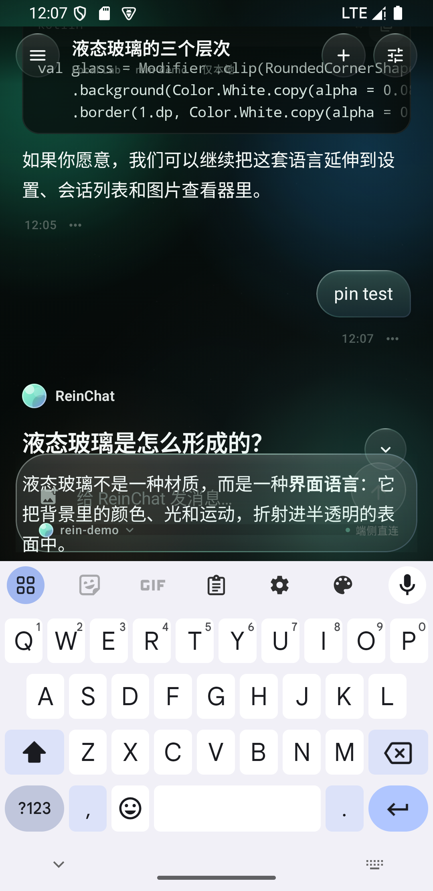 |

---

## 版本

### 0.4.4 — 2026-11-15

- Web 流式输出修复：搜索模式下最终回答重新逐段推送
- 思考/生成状态移入消息区，不再显示在输入栏
- 会话级流式任务：切换会话仍可在其他会话输入
- 修复切换会话后保存错会话导致的 `invalid_json`
- 联网默认开启，思考程度默认 `high`
- App 同步默认开启联网、新服务商默认思考高

### 0.4.3 — 2026-11-14

- 会话列表在顶部时顶部栏渐变完全透明
- 列表向上滚动后，顶部栏渐变随滚动距离逐渐恢复
- 滚动回顶部时再次变为透明
- Web 端企业级 UI/UX 重构：玻璃模糊、Markdown、表格、代码块、自定义下拉、新建会话、服务商管理、网页 ICON
- 新品牌图标：纯白背景 + 绿色衬线 R

### 0.4.2 — 2026-11-14

- App 每次启动自动请求 `version.txt` 检查版本
- 支持强制/可选更新弹窗，强制更新不可关闭
- 下载按钮打开 Cloudreve APK 地址
- 版本号按数字段比较，0.4.10 > 0.4.9

### 0.4.1 — 2026-11-14

- 服务端识别 DeepSeek DSML 工具调用，不再把 `< | | DSML | | ...>` 原样发给客户端
- 支持 DSML 工具调用执行后继续生成
- 客户端展示层兜底过滤历史消息中的 DSML 标记

### 0.4.0 — 2026-11-13

- LV2 强制使用官方中转，自动上传未同步 Provider
- 官方中转支持 `model`、`reasoningEffort`
- LV2 新增联网搜索开关；服务端向 LLM 提供 `web_search` / `fetch_url` agent 工具
- Markdown 表格解析与渲染
- Web 端补齐自绘滚动条、模型/思考选择、联网、置底、重试、编辑、回退

### 0.3.6 — 2026-11-13

- 修正 Android 云端 SSE 删除处理：当前会话被网页删除时会触发完整云端同步
- App 订阅 SSE 后，网页端新建/修改会话会自动刷新 App 当前会话
- 保留 0.3.5 的实时事件订阅和 0.3.4 的 Kimi 风格布局

### 0.3.5 — 2026-11-13

- Android 登录后订阅 `/api/v1/events` SSE
- 网页端修改/新建/删除云端会话后，App 当前会话自动刷新
- SSE 断线指数退避重连；收到过期 token 时走原有登录失效流程
- 保留 0.3.4 的 Kimi 风格 90% 不透明标题栏/输入栏与渐隐过渡

### 0.3.4 — 2026-11-13

- 改为 Kimi 风格：标题栏和输入栏使用 **90% 不透明度暗色**
- 标题栏底部使用透明→不透明渐变，消息滚动时柔和淡入标题栏，不再有硬边界
- 输入栏上方增加透明→90% 暗色渐变，内容自然淡入输入区
- 移除全部模糊、透明玻璃和模糊副本；无发光、无 ghost、无 BlurView 崩溃
- 保留底部跟踪模式、输入栏动态避让、置底按钮避让、侧边栏 230ms

### 0.3.3 — 2026-11-13

- 尝试原生重构：拆出 content/chrome ComposeView，内容放入 BlurTarget，标题栏/输入栏由原生 BlurView 覆盖
- BlurView 2.0.6 即使作为 ComposeView 外部兄弟 View，仍在 `PreDrawBlurController.updateBlur` 中触发
  Compose 绘制期间的 `performMeasureAndLayout`，直接崩溃，无法稳定接入
- BlurView 4.x 在 API 31+ 依赖 RenderEffect/RenderNode，而卓易通上 RenderEffect 无效，仍无模糊
- 已撤回原生重构和 BlurView 依赖，恢复单 ComposeView 干净玻璃
- 保留底部跟踪、输入栏动态避让、置底按钮避让、侧边栏 230ms

### 0.3.2 — 2026-11-12

- 尝试接入 Dimezis BlurView：2.0.6 的 `PreDrawBlurController` 在 Compose 测量阶段触发
  `performMeasureAndLayout called during measure layout`，直接崩溃
- BlurView 4.x 在 API 31+ 走 RenderEffect/RenderNode，而卓易通上 RenderEffect 实际无效，无法得到真模糊
- 因此撤回 BlurView 依赖，恢复无发光、无崩溃的干净玻璃
- 保留 0.3.1 的底部跟踪模式、输入栏动态避让、置底按钮避让、侧边栏 230ms 动画

### 0.3.1 — 2026-11-12

- 新增底部跟踪模式：滑到列表底部后自动跟随新内容；手动向上拖动立即脱离；回到底部重新进入
- 右下角“置底”按钮与输入栏的实际高度联动，不再重叠
- 列表底部按输入栏实测高度动态留白，滑到底部不再被遮挡
- 侧边栏展开动画从 440ms 缩短到 230ms，遮罩 150ms，减少“点了半秒才出来”的迟钝
- **背景模糊**：继续保留 0.3.0 的干净半透明玻璃；未再启用会产生发光/ghost 的模糊副本。真背景模糊需要原生 BlurView/系统窗口模糊，未在本版硬实现

### 0.3.0 — 2026-11-12

- **撤回伪背景模糊**：卓易通/部分设备的 RenderEffect 是 no-op，继续叠加只会产生发光/重影
- 标题栏、输入栏恢复为干净的半透明暗色玻璃，不再有外发光、色边或 ghost
- 输入栏底部安全区改成按实际测量高度动态预留：`onSizeChanged` → 列表 bottom padding
- 右下角“置底”按钮改为跟随输入栏实际高度上移，不再与输入栏重叠
- 状态栏仍绘制在标题栏区域内；不再绘制无效的模糊副本
- 真正的 backdrop blur 需要原生 BlurView/系统窗口模糊，当前实现先保证不发光、可读、布局正确

### 0.2.9 — 2026-11-12

- 修复“文字发光”回归：v0.2.7 把全屏模糊副本放在清晰文字**后面**，模糊字形从清晰字形边缘漏出，形成光晕
- 改为先画清晰正文，再把**不透明磨砂片**只合成到顶部/底部区域；正文后面不再有模糊层，光晕消失
- 磨砂片由深色底 + 模糊内容组成，再通过 `DstIn` 渐变蒙版裁切，顶部/底部过渡自然
- 状态栏、标题栏、输入栏继续使用真实高斯模糊；中间正文保持清晰
- 0.2.9 为发光问题的撤回修复版

### 0.2.8 — 2026-11-12

- 对比图问题修复：0.2.6 的标题栏仍是暗色遮罩，不像玻璃；0.2.8 降低 tint 到 20%/10%，让真实模糊层露出来
- 输入栏 tint 降到 20%，模糊内容可见但经过模糊不可读
- 状态栏继续沿用自定义背景模糊，不再有独立黑条
- 增加 Markdown 回归测试：`###标题` 紧跟在普通段落后（无空行）也必须被解析
- 单元测试从 19 增至 20

### 0.2.7 — 2026-11-12

- 放弃 Haze 实现，改为自研 `BackdropBlur`：内容只组合一次，记录到两个 `GraphicsLayer`
- 一份原始内容、一份 `BlurEffect` 高斯模糊副本；用 `DstIn` 垂直 alpha 渐变裁切
- 顶部/底部显示真实模糊副本，中间显示清晰正文，过渡为渐变而非硬切
- 状态栏纳入模糊区域：内容绘制到屏幕顶部，标题栏内容加 `statusBars` 内边距
- 标题栏使用暗色渐变 tint，输入栏使用 40% 暗色 tint，保留可读性
- 移除 Haze 依赖，避免其 RenderEffect 在部分设备上失效

### 0.2.6 — 2026-11-12

- 修复“看起来没模糊”：Haze 背景原来设为透明，导致模糊副本下面仍能看到 100% 锐利的原始文字
- 标题栏/输入栏改为**不透明暗色底 + 模糊副本**，盖住原文字，模糊才真正可见
- 标题栏使用垂直渐变 mask：顶部完整玻璃层，向下逐渐透明，边界柔和
- 保持顶部 40dp 强模糊、向下衰减到 0 的 progressive blur
- 输入栏使用不透明暗色玻璃底，避免原始文字透出抢可读性

### 0.2.5 — 2026-11-12

- 标题栏/输入栏改为真正的背景高斯模糊（Haze `RenderEffect`），不再只是透明
- 标题栏改为**渐变模糊**：顶部最强，向下逐渐减到 0；暗色 tint 同步淡出，边界自然消失
- 提高玻璃暗色 tint 比例，解决“全透明导致可读性过低”
- 输入栏保持圆角玻璃 + 背景模糊，内容从下方隐约透出
- 低版本 Android 无 RenderEffect 时回退为半透明 tint

### 0.2.4 — 2026-11-12

- HyperOS 3 体验修复：标题栏/输入栏改为悬浮半透明层，消息从下方透出，不再硬切遮挡
- 消息列表改为正序布局；流式增量不再带动视窗下滑，保持当前阅读位置
- 切会话不再取消后台生成；生成中的会话可以离开再回来继续查看
- 新增 `ChatStreamService` 前台服务与通知，降低后台被 HyperOS 冻结/掐断的概率
- 新增“回到最新消息”行为适配正序列表
- 说明：真正的后台续跑（进程被杀后恢复）仍需服务端中转任务

### 0.2.3 — 2026-11-09

- Markdown 标题兼容 `###标题`（井号后无空格）等模型常见输出
- 支持解析 `delta.reasoning_content` 与 Responses reasoning 事件
- 新增思考块：思考中自动展开并实时显示思维链，正文出现后自动收起；用户可点击头部手动展开/收起
- 思考块支持 Markdown、超长内容内部滚动、思考中光标
- 新增“思考强度”：自动 / 低(low) / 高(high) / 最高(max)，可在模型选择弹窗和服务商编辑页调整
- 仅收到 reasoning、没有正文时保留思考块并提示“未生成正文”，不再丢弃整条回复

### 0.2.2 — 2026-11-09

- **API Key 改为强制纯 ASCII 清洗**：自动移除中文、全角字符、表情与隐藏字符，不再以“不能用于 HTTP 请求头”阻止发送
- API Key 编辑器提示会自动清理；保存时清理掉字符会提示用户
- 这是针对复制 API Key 时混入中文标点/拼音/注释字符的实际场景修复
- **平滑流式输出**：SSE delta 先进入缓冲，由 16ms 帧循环按积压量自适应加速吐出；结束时一次性 flush，避免整段文字突然跳出
- 平滑输出不改变最终 Markdown、停止生成、回退和云端同步逻辑
- Markdown 标题兼容模型常见的 `###标题`（井号后无空格）写法
- 新增推理思考块：思考中自动展开实时思维链，正文出现后自动收起，支持手动展开/收起
- 新增“思考强度”控制：自动 / 低(low) / 高(high) / 最高(max)，在模型选择弹窗和服务商编辑页均可调整
- 解析 `delta.reasoning_content`（Venice/DeepSeek/OpenRouter 常见字段）及 Responses reasoning 事件

### 0.2.1 — 2026-11-09

- 服务商模型支持英文逗号分隔多个模型，对话页可在同一服务商内切换模型
- 错误回复气泡支持“重试”，重新生成对应提问的答案
- 修复从富文本/截图复制 API Key 时的不可见字符报错：自动清理零宽字符、换行、全角空格与变体连字符
- Windows 桌面版（Tauri 2.12 + Rust + 原生 TypeScript + Vite）完成调试版验证，发布暂缓

### 0.2.0 — 2026-11-09

- 新增账号注册 / 登录与 30 天 token 自动登录
- 新增“聊天记录保存云端”：仅新建会话可开启，开启后不可关闭，登录用户默认开启
- 云端会话创建、更新、删除与跨设备继续
- 新增服务商“仅保存在本机”开关与云端同步，默认仅本地
- 新增 Go + SQLite 自托管后端、Docker Compose、Caddy 自动 HTTPS 与部署文档
- 新增登录页、账户卡片、同步状态与云端标识
- 云端图片上传 / 下载路径与远端文件 ID 引用
- 退出登录清理本机云缓存，避免账号间数据泄露
- 同步修复 `Authorization` 头非法字符的友好报错

### 0.1.1 — 2026-11-09

- 修复鸿蒙 / 卓易通环境下服务商配置重启丢失
- 服务商配置改为同步、可验证的原子持久化
- 加密方式改为跨进程可用的本地 AES-GCM，并兼容旧格式迁移
- 消息气泡整块点按展开菜单，且同时只展开一条
- 图片查看器改为全屏不透明背景，缩放提示避开系统手势区
- 修正加密说明文案与版本号

### 0.1.0

- 首个 v0.1 原型：流式对话、回退、编辑、服务商、图片、会话管理、液态玻璃 UI

---

## 交付文件

- `dist/ReinChat-0.4.4.apk` — Android release，正式侧载
- `dist/ReinChat-0.4.4-debug.apk` — Android 调试包，与正式包可共存
- `desktop/` — Tauri 桌面端源码（开发暂缓，未提供安装包）
- `server/` — Go 后端源码、测试、Docker/Caddy 部署文件
- `deploy.sh` — 当前 1Panel 生产环境的一键构建、上传、systemd 部署脚本
- `server/bin/reinchat-server-linux-amd64` — 预编译 Linux amd64 服务端
- `screenshots/` — 16 张 1080×2220 界面截图

### SHA-256

| 文件 | SHA-256 |
| --- | --- |
| `ReinChat-0.4.4.apk` | `8FE711474CC2742A81049D1002B52A59E4731F2A4AA2D5459A6940378EC60FD9` |
| `ReinChat-0.4.4-debug.apk` | `E265834ACBCD11DCD61AA80B4B7C34CE4317AAA72394060F0F3536346998217C` |
| `server/bin/reinchat-server-linux-amd64` | `9A27B1F6E2C7089E978E553AD5360AB60334CD47F48D0244272036522BE341FA` |

---

## 许可

v0.2 内部预览版本。未附带开源许可证；如需开源或商用，请先与项目作者确认。
