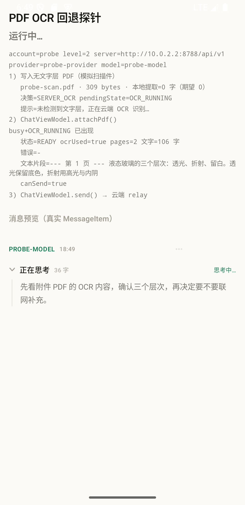
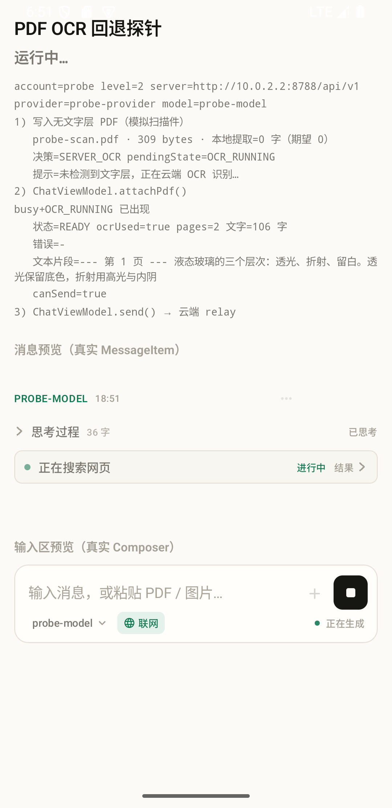
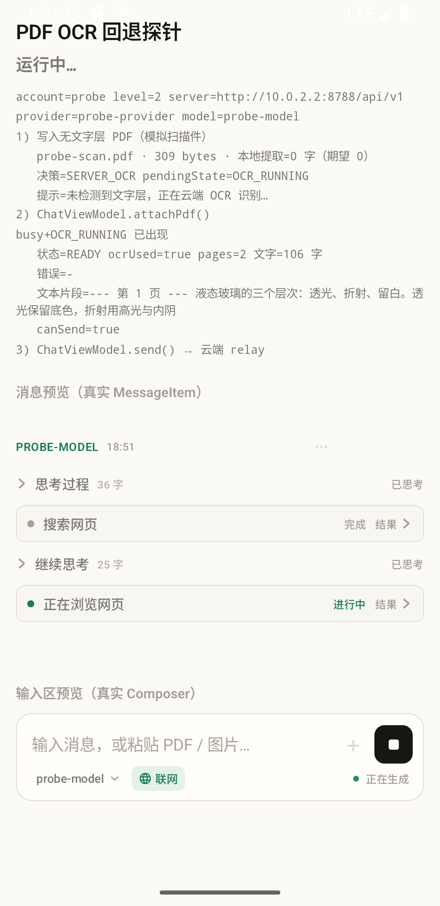
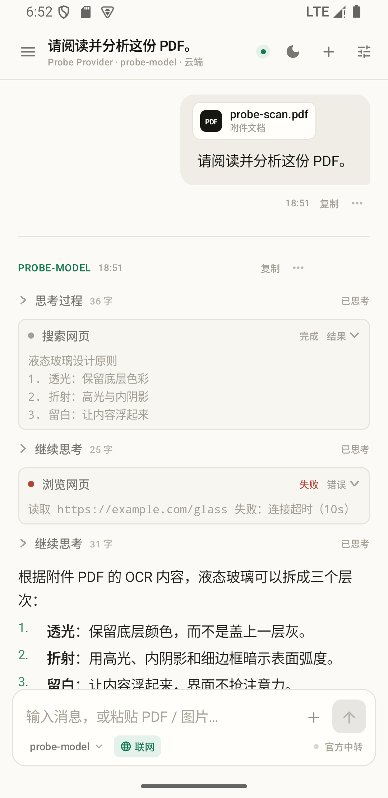
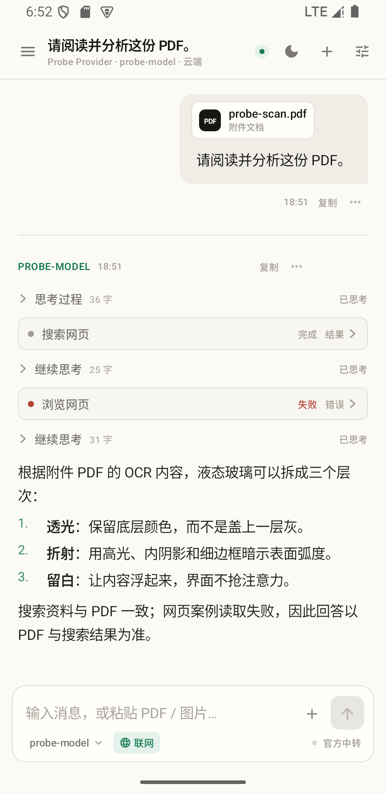
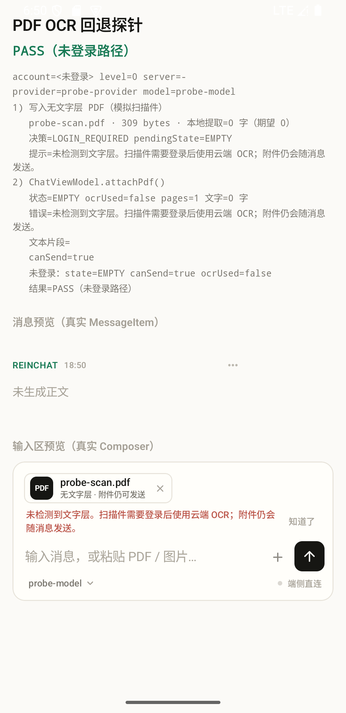
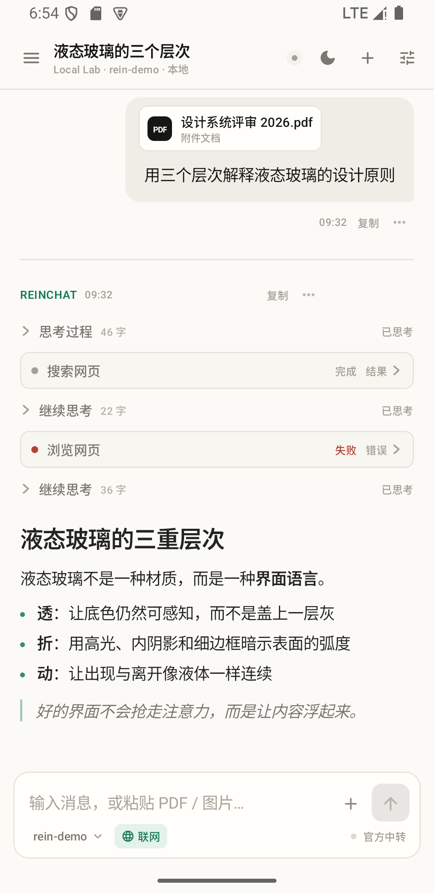
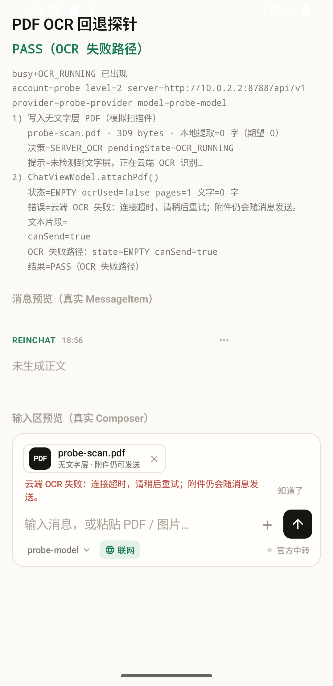

# Android PDF OCR fallback & tool timeline verification

This document covers the Android-only work for:

1. scanned-PDF OCR fallback (`/api/v1/pdf/ocr`) and its login explanation;
2. chronological thinking/tool segments from the cloud relay, including
   persistence across save / refresh;
3. process wording: `正在思考` / `正在搜索网页` / `正在浏览网页`.

Nothing under `web/`, `web-vue2/` or `server/` was changed.

## 1. PDF OCR fallback

The local extractor (`PdfTextExtractor`) stays dependency-free. A scanned PDF
(no text layer, or CID text without a ToUnicode map) yields an empty result, and
the decision is made by `PdfTextPolicy`:

| Local text | Signed in | Result |
| --- | --- | --- |
| found | any | `LOCAL_TEXT` → `READY`, no network call |
| empty | yes | `SERVER_OCR` → `OCR_RUNNING`, `POST /api/v1/pdf/ocr`, busy state |
| empty | no | `LOGIN_REQUIRED` → `EMPTY`, attachment kept, UI explains login |

The signed-out branch deliberately keeps the attachment:

* the composer chip reads `无文字层 · 附件仍可发送`;
* a persistent hint reads
  `未检测到文字层。扫描件需要登录后使用云端 OCR；附件仍会随消息发送。`;
* the send button stays enabled (`ChatUiState.canSend`), and `send()` only blocks
  while the PDF is still busy (`PENDING/EXTRACTING/OCR_RUNNING`).

OCR success stores `text`, `pages` and `ocrUsed=true` on the attachment. OCR
failure (`422 ocr_empty`, auth expiry, network) keeps the PDF attached with an
explicit message instead of dropping it. If the text is still empty when the
message is sent, the default prompt says the text layer is missing rather than
pretending the model can read it.

Every outgoing message stores `pdfName` + `pdfText`. Both delivery paths forward
the text:

* relay: `CloudMessageDto.pdfText` → server `buildRelayRequest` appends
  `[附件 PDF：…]` + text;
* direct provider: `directMessageText()` inlines the same block.

## 2. Tool history visibility

`RelayEventParser` decodes the relay SSE frames (unit-tested):

* `snapshot` → `StreamEvent.Snapshot(text, reasoning, tools)` – replays the job's
  accumulated text/reasoning and tool history when the stream opens;
* `reasoning` → thinking delta;
* `tool` → `running` / `done` / `failed` update;
* `status: completed|cancelled|failed` → terminal frame.

`ProcessTimeline` keeps the chronological order:

```
reasoning A → tool web_search (running→done) → reasoning B
            → tool fetch_url (running→failed) → reasoning C
```

A tool update always appends after the thinking block before it; the next
reasoning delta opens a new block. A `done`/`failed` event updates the running
card in place, and replayed snapshot tools update existing finished cards instead
of duplicating them.

`MessageItem` renders the segments in order:

* thinking header `正在思考` while the block is live, then `思考过程` /
  `继续思考`;
* tool cards `正在搜索网页` / `正在浏览网页` while running, `搜索网页` /
  `浏览网页` when finished, `失败` in red for failures;
* the tool card ends the preceding thinking block and auto-collapses it;
* only the trailing live thinking block auto-expands; completed ones collapse
  unless the user toggled them;
* `结果` / `错误` toggles expand the tool detail;
* the final answer body is rendered separately below the timeline.

Persistence: `ChatMessage.segments` is part of the local archive
(`ConversationStore`, `encodeDefaults = true`) and of
`CloudMessageDto.segments`. `CloudMessageWireTest` and
`ConversationSerializationTest` lock the model/wire round-trip in place.

## 3. Verification performed (emulator, debug build)

* `:app:assembleDebug` and `:app:testDebugUnitTest` pass.
* OCR probe against a local mock cloud server (`tools/mock_cloud_ocr_server.py`):

```
GET  /api/v1/auth/me
POST /api/v1/pdf/ocr multipart_bytes=545
POST /api/v1/relay/jobs messages=1 pdfTextChars=[106]
PUT  /api/v1/conversations/<id> messages=2 segments=5
```

* Probe log (logcat tag `OcrProbe`):

```
probe-scan.pdf · 309 bytes · 本地提取=0 字（期望 0）
决策=SERVER_OCR pendingState=OCR_RUNNING
busy+OCR_RUNNING 已出现
状态=READY ocrUsed=true pages=2 文字=106 字
canSend=true
segment[1] type=tool name=web_search status=done label=搜索网页
segment[3] type=tool name=fetch_url status=failed label=浏览网页
用户消息 pdfText=106 字 pdfName=probe-scan.pdf
结果=PASS
```

* Signed-out probe: `决策=LOGIN_REQUIRED`, `状态=EMPTY`, `canSend=true`,
  `结果=PASS（未登录路径）`.
* OCR failure probe (mock server stopped): `状态=EMPTY`,
  `错误=云端 OCR 失败：连接超时，请稍后重试；附件仍会随消息发送。`,
  `canSend=true`, `结果=PASS（OCR 失败路径）`. Transport errors are mapped to a
  cloud error in `ocrPdf` so the composer never reports a misleading parse error.
* Cloud refresh: deleted `files/conversations.json`, relaunched the app; it
  fetched `GET /api/v1/conversations/<id>` and rendered the same five segments
  (screenshot 5).

Screenshots (emulator, 1080×2220):

| Screenshot | Shows |
| --- | --- |
|  | `正在思考`, thinking block auto-expanded |
|  | `正在搜索网页 / 进行中`, previous thinking collapsed |
|  | `正在浏览网页 / 进行中`, search card done |
|  | cloud-loaded segments after refresh + expanded `结果`/`错误` |
|  | conversation restored from the cloud after deleting local archive |
|  | signed-out composer: `无文字层 · 附件仍可发送` + login hint |
|  | seeded demo: thinking A → search → thinking B → browse → thinking C → final body |
|  | OCR failure: `云端 OCR 失败：连接超时…`, attachment kept, send enabled |

## 4. Reproduce

```bash
# 1. mock cloud server (OCR + relay SSE with tool events)
python tools/mock_cloud_ocr_server.py --port 8788

# 2. debug build
./gradlew :app:assembleDebug :app:testDebugUnitTest
adb install -r app/build/outputs/apk/debug/app-debug.apk

# 3. seed a logged-in cloud account pointed at the emulator host
adb shell am force-stop com.reinchat.app.debug
adb shell am start -n com.reinchat.app.debug/com.reinchat.app.DebugSeedActivity \
  --ez demo_cloud true --es cloud_server http://10.0.2.2:8788

# 4. run the OCR probe (writes a no-text-layer PDF, attaches, OCR, sends)
adb shell am start -n com.reinchat.app.debug/com.reinchat.app.DebugOcrProbeActivity
adb logcat -s OcrProbe

# signed-out branch
adb shell am start -n com.reinchat.app.debug/com.reinchat.app.DebugSeedActivity \
  --ez demo_cloud true --ez no_cloud true --es cloud_server http://10.0.2.2:8788
adb shell am start -n com.reinchat.app.debug/com.reinchat.app.DebugOcrProbeActivity --ez no_cloud true

# OCR failure branch (stop the mock server first)
adb shell am start -n com.reinchat.app.debug/com.reinchat.app.DebugOcrProbeActivity --ez attach_only true
```

The mock server appends every request to
`tools/mock_cloud_ocr_requests.log` and writes the relay POST body to
`tools/mock_cloud_ocr_requests-relay-body.json` (both git-ignored).

## 5. Remaining gaps

* The OCR endpoint itself was exercised against a mock that returns canned text;
  the real server still needs `pdftoppm` + `tesseract` (`chi_sim+eng`) on the
  host. The Android client path (multipart upload, busy state, result parsing,
  attachment/relay forwarding) is what was verified end-to-end.
* OCR requires a signed-in cloud account. There is no on-device OCR engine, so a
  signed-out user can attach a scanned PDF but its text cannot be read.
* The local extractor only handles simple, non-encrypted PDFs with a text layer;
  anything else depends on the server round-trip (up to 240 s request timeout).
* Text is capped at the server's 60k characters and the relay/provider context;
  very large scanned documents may be truncated.
* The PDF file is deleted from the composer cache after sending (the extracted
  text is stored on the message); re-sending requires re-attaching the file.
