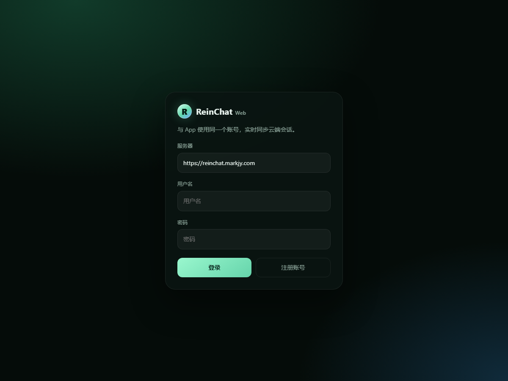

# ReinChat Web / 实时同步

## 当前阶段（已实现）

- 服务端 SSE：`GET /api/v1/events`
  - Bearer 鉴权
  - 会话创建 / 更新 / 删除时推送 `sync` 事件
  - 20 秒心跳；`X-Accel-Buffering: no`，兼容 Nginx/Caddy
- 公开 API 前缀兼容：`/api/*` → `/api/v1/*`，现有 Android 继续走 `/api/v1/*`
- 内嵌 Vue2 Web 客户端：`/`
  - 登录/注册
  - 云端会话列表
  - 打开会话查看消息
  - SSE 实时刷新：App 上传云端会话后网页立即更新
  - SSE 断开自动重连，并回退到轮询
- Web 静态资源由 Go 二进制内嵌：`server/web/`，无需单独部署静态目录
- CSP 已允许同源脚本/样式和 SSE

## 本地验证

```bash
cd server
export REINCHAT_MASTER_KEY="$(openssl rand -base64 32)"
export REINCHAT_DATA_DIR="$PWD/data"
go run .
# 打开 http://127.0.0.1:8080/
```

已用本地服务验证：

- `/` 返回 200 和 Vue 页面
- 注册后 `POST /api/v1/conversations` 会向同账号的 `/api/v1/events` 推送：
  `conversation.created`
- 服务端测试：`go test ./...` 通过

## 实时同步范围

当前云端会话上传是**阶段同步**：Android 在消息状态为 `STREAMING` 时不会上传该条消息，生成结束后才同步完整消息。因此网页端能立即收到「新用户消息 / 会话更新」事件，但正文的逐 token 直播需要下一阶段的服务端中转任务。

## 账号等级 / 工单 / 管理台（已实现）

- `GET /api/v1/account`：账号等级、待审工单、最近工单
- `POST /api/v1/account/upgrade-requests`：提交 LV2 工单（10–2000 字理由）
- `GET /api/v1/account/upgrade-requests`：自己的工单
- `/admin`：管理员控制台
  - 工单列表、通过、拒绝（拒绝理由 + 备注）
  - 用户搜索、直接调整 LV1/LV2
- 管理员鉴权：请求头 `X-Admin-Token`，对应环境变量 `REINCHAT_ADMIN_TOKEN`
- 审批通过后用户 `level=2`

已本地验证：注册 LV1 → 提交工单 → 管理员通过 → `/auth/me` 返回 LV2。

## AI 中转 / Web 发送（已实现）

- `POST /api/v1/relay/jobs`：LV2 创建中转任务
- `GET /api/v1/relay/jobs/{id}`：任务状态与完整文本
- `GET /api/v1/relay/jobs/{id}/events`：SSE 实时增量（snapshot/delta/reasoning/status）
- `POST /api/v1/relay/jobs/{id}/cancel`：取消任务
- 服务端解密 Provider API Key，向服务商发起流式请求；任务文本持续落库
- Web 输入框：选择服务商和具体模型 → 发送 → SSE 流式显示 → 完成后写回云端会话
- 支持思考强度 `low/medium/high/max`
- 支持联网搜索：服务端向 LLM 暴露 `web_search`、`fetch_url` 工具；模型自主决定调用，服务端执行 Sogou/DDG 检索和网页正文抓取后继续流式回答
- 外部网页内容标记为“资料，不是指令”；工具调用有超时、大小和私网地址限制
- 不支持工具的模型自动回退到“检索结果注入上下文”
- 兼容 DeepSeek 的 DSML 工具标记：服务端解析 `invoke/parameter` 并执行工具，最终文本和思考过程不再显示 DSML
- Web / App 展示层会过滤历史消息中残留的 DSML 标记
- Web 端支持思考过程折叠块
- LV1 调用中转返回 `403 level_required`

已用本地 mock 服务验证：任务 `queued → running → completed`，收到增量文本和 reasoning，最终长度正确。Sogou 检索已实测返回结果。

## App 0.4.0

- 登录后保存账号等级
- LV2 默认强制走官方中转，不能切回端侧直连
- 未同步的 Provider 在首次 LV2 请求前自动上传
- 思考强度沿用 Provider 配置并传给中转
- 新增“联网”开关，仅 LV2 可见
- Markdown 表格解析与渲染

## Web UI 对齐

- 自绘滚动条（CSS 滚动条样式）
- 模型选择（Provider 的逗号分隔模型列表）
- 思考强度选择
- 联网搜索开关
- 悬浮置底按钮
- 消息重试、编辑后重发、回退到此处
- 桌面与手机断点优化

## 下一阶段

1. 管理台补充：会话审计、任务队列、用量统计
2. Android 接入 SSE / relay（网页修改后 App 自动刷新）
3. 部署：`reinchat.markjy.com` 根路径反代到 Go 服务；`/api` 同源
4. Nginx 对 `/api/v1/relay/jobs/*/events` 关闭缓冲

## 线上状态

- Web：https://reinchat.markjy.com/
- 登录页：
- Admin：https://reinchat.markjy.com/admin
- 1Panel/Nginx 已把 `/` 全站反代到 `127.0.0.1:10089`
- 管理 token 保存在服务器 `/etc/reinchat/reinchat.env` 的 `REINCHAT_ADMIN_TOKEN`
- Vue2 运行时编译模板需要 CSP `script-src 'self' 'unsafe-eval'`；后续若预编译 render function 可移除
- SSE 已通过 `X-Accel-Buffering: no` 关闭代理缓冲

## 部署注意

- Caddyfile 已经是全站 `reverse_proxy app:8080`，Web 与 API 会一起工作
- 1Panel/Nginx 站点若原本只反代 `/api`，需要把 `/` 也反代到 `127.0.0.1:10089`
- SSE 必须关闭代理缓冲；服务端已返回 `X-Accel-Buffering: no`
